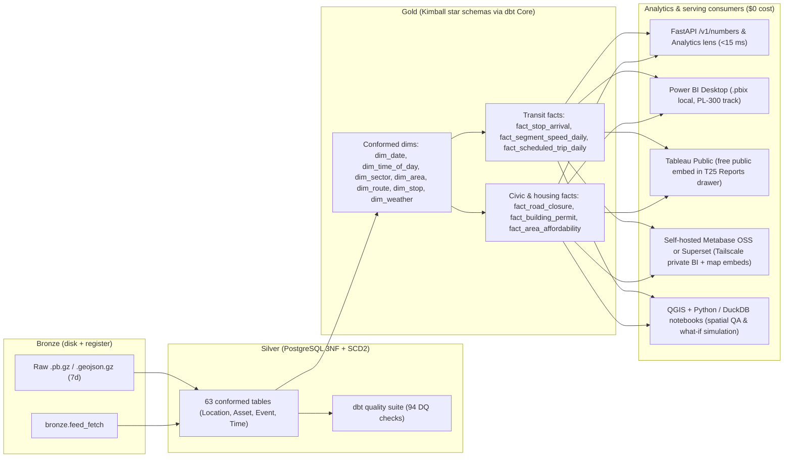

# Optimization and analytics roadmap

25 Nov 2026 · Prepared for Emmanuel Mbachu

> **Operational check before 29 Nov 2026:** The loaded Halifax Transit GTFS static schedule (`SRC-004`, version `2026_08_August_20260806`) expires in **four days on 29 Nov 2026**. Run the schedule loader once Halifax Transit publishes the next `google_transit.zip`, and register `scripts/collector-register-task.ps1` and `scripts/sector-register-task.ps1` so collection and 6-hour ArcGIS refreshes survive logoffs.

---

## 1. Live baseline measured on `halifax_twin` (25 Nov 2026)

After **3.5 days** of continuous collection (since 21 Nov 2026 at 21:05), `halifax_twin` holds:

| Table | Live rows | Dead tuples | Size on disk | Growth rate |
| :---- | ----: | ----: | ----: | :---- |
| `silver.vehicle_position_2026_11` | 543,921 | 0 | 134 MB | ~155,000 rows/day (~4.6M/month, ~1.1 GB/month) |
| `silver.event` | 234,099 | **43,062** | 101 MB | ~65,000 rows/day + heavy MVCC churn |
| `silver.stop_arrival` | 209,167 | **26,886** | 49 MB | ~60,000 rows/day + heavy MVCC churn |
| `bronze.feed_fetch` | 18,368 | 0 | 4.9 MB | ~5,200 rows/day (~1.9M/year) |

### Measured cold HTTP response times and payload sizes (`127.0.0.1:8010`)

| Endpoint | Latency (ms) | Payload size | Primary bottleneck |
| :---- | ----: | ----: | :---- |
| `/v1/numbers/trn.slowest_segments` | **2,116 ms** | 0.7 KB | 28-day on-demand SQL function + PostGIS geography math |
| `/v1/numbers/trn.bunched_share_7d` | **2,069 ms** | 0.7 KB | 7-day `CROSS JOIN LATERAL` calling `planned_stop_time` twice/day |
| `/v1/numbers/trn.excess_wait_by_route` | **2,002 ms** | 1.0 KB | 7-day unmaterialized window sorts over `observed_stop_arrival` |
| `/v1/numbers/trn.bunched_by_hour` | **1,998 ms** | 1.1 KB | Recomputes the exact same 7-day headway scan a second time |
| `/v1/numbers/trn.excess_wait_7d` | **1,955 ms** | 0.7 KB | Recomputes the exact same 7-day wait scan a second time |
| `/v1/numbers/trn.slow_segments_count` | **1,828 ms** | 0.7 KB | Recomputes the exact same 28-day segment scan a second time |
| `/v1/layers/building-permits` | **866 ms** | **1,424.8 KB** | No GZip + Python `json.loads` / `json.dumps` on 5,000 features |
| `/v1/layers/routes` | **813 ms** | **838.1 KB** | No GZip + live `ST_SimplifyPreserveTopology` on 81 MultiLineStrings |
| `/v1/layers/stops` | **707 ms** | **1,227.4 KB** | No GZip + double JSON serialization on 2,358 stops |
| `/v1/numbers/trn.late_share_by_hour` | **865 ms** | 1.3 KB | Unmaterialized `gold.route_lateness_by_hour` (called 3x on `TRN-Q02`) |
| `/v1/numbers/trn.delay_near_closures_by_reason` | **606 ms** | 0.8 KB | Live unindexed `ST_Transform(..., 32620)` + double 7-day arrival scan |

> **Scaling warning:** At 3.5 days of history, the transit analytics queries already take **2.0 seconds**. By day 28 (when `TRN-Q09` and `TRN-Q11` unlock automatically and `stop_arrival` reaches ~1.7 million rows), those queries will approach or exceed the 10-second `statement_timeout` in `services/api/halifax_api/db.py` and return `503`.

---

## 2. Where to optimize the application (ranked by impact)

### A. Database and collector optimizations

| Priority | Area | Finding | Fix and expected gain |
| :---- | :---- | :---- | :---- |
| **P0** | **Gold materialization** (`database/gold/`) | `gold` currently has **zero tables or materialized views**—only 9 `LANGUAGE sql` functions (`planned_stop_time`, `observed_stop_arrival`, `stop_headway`, etc.) using `generate_series` + `CROSS JOIN LATERAL` on every cache miss. `stop_headway` evaluates `planned_stop_time` (~145k rows/day) twice per day. | Build incremental **Gold Kimball star tables** (`fact_stop_arrival`, `fact_segment_speed_daily`, `fact_scheduled_trip_daily` + `dim_*`). Cuts 1,800–2,100 ms queries to **<15 ms** and solves `DQ-043` (18% off-by-one `stop_sequence` mismatch) in one place. |
| **P0** | **Collector MVCC write amplification** (`services/collector/transit_realtime/store.py`, `collector.py`) | Every 30 s, `transit_realtime` parses unchanged `.pb` feeds and runs `ON CONFLICT DO UPDATE SET ..., dw_loaded_ts = now()` with **no `IS DISTINCT FROM` guard**, rewriting ~3,000–6,000 unchanged arrival and trip rows per cycle (~8M–17M dead tuples/day). `gtfs_schedule/loader.py` does the same across 9,600 SCD2 rows. | Skip Silver writes when `d.sha256 == last_sha`, and add `WHERE (...) IS DISTINCT FROM (...)` to `transit_realtime/store.py` and `gtfs_schedule/loader.py` (matching `hrm_arcgis/store.py`). Cuts WAL/dead-tuple churn by **>90%**. |
| **P0** | **Missing hot-path indexes** (`database/sql/03_foreign_keys_and_indexes.sql`) | 1. `silver.vehicle_position` PK is `(vehicle_asset_id, position_ts)`—there is **no `(position_ts)` index** for `/v1/live/vehicles` (`last 180s`) or `/v1/replay/vehicles`. 2. `silver.event` lacks `(event_type_code, event_start_ts)` and `(source_id, dw_loaded_ts)` (slowing `stories.py` archive checks and `sources.py` freshness checks). 3. `silver.scheduled_trip` lacks `(source_trip_key, route_asset_id)`. | Add B-tree indexes on `vehicle_position (position_ts DESC)`, `event (event_type_code, event_start_ts)`, `event (source_id, dw_loaded_ts DESC)`, and `scheduled_trip (source_trip_key, route_asset_id)`. Drop the 5 redundant single-column FK indexes that duplicate `ak1_*` prefixes (`ix_event_source_id`, `ix_stop_arrival_trip_event_id`, etc.). |
| **P1** | **Partitioning and retention** (`database/sql/05_vehicle_position_partitions.sql`, `06_bronze_register.sql`) | `silver.event` and `silver.stop_arrival` grow ~45M rows/year unpartitioned alongside small civic tables; `bronze.feed_gap` runs an unbounded window scan over all history. | Bound `bronze.feed_gap` (or add a parameterized recent-gap check) and define a 90-day raw-GPS partition retention policy once `fact_stop_arrival` and `fact_segment_speed_daily` preserve condensed history. |

---

### B. FastAPI serving layer optimizations

| Priority | Area | Finding | Fix and expected gain |
| :---- | :---- | :---- | :---- |
| **P0** | **HTTP compression & HTTP caching** (`services/api/halifax_api/main.py`) | FastAPI has **no `GZipMiddleware`** and emits no `ETag` or `Cache-Control` headers. Initial map layers (`routes` + `stops` + `building-permits`) transfer **3.49 MB uncompressed** (critical over Tailscale and mobile). | Add `app.add_middleware(GZipMiddleware, minimum_size=1000)` and weak `ETag` / `304 Not Modified` support. Shrinks initial GeoJSON transfer from **3.49 MB to ~380 KB** (~9x smaller). |
| **P1** | **Eliminate double GeoJSON serialization** (`services/api/halifax_api/layers.py`) | `layers.py` fetches `ST_AsGeoJSON(geom, 6)` strings from PostgreSQL, parses up to 5,000 geometries with `json.loads()` in Python, and re-serializes them with `json.dumps()`. | Build the GeoJSON `FeatureCollection` directly in PostgreSQL (`jsonb_build_object`) or serialize with `orjson`. Cuts cold `/v1/layers/*` latency from **700–866 ms to ~80–150 ms**. |
| **P1** | **Pool circuit-breaker bug & shared story cache** (`services/api/halifax_api/db.py`, `numbers.py`) | 1. Catching `PoolTimeout` in `db.py` trips a **10-second global 503 circuit breaker** across the entire API when 8 connections are busy. 2. Sibling numbers on one story (`TRN-Q01`, `Q02`, `Q03`, `Q04`, `Q11`) each run the same expensive SQL independently, and `TTLCache` has no single-flight lock or `maxsize`. | Remove `PoolTimeout` from `_down_until` (raise local `503` for that slow query only, preserving small blast radius), set `min_size=2, max_size=12`, add per-key single-flight locking + `maxsize=256` to `TTLCache`, and cache shared base datasets across sibling numbers. |
| **P2** | **Cache `/v1/sources` & `/v1/features/*` and batch `/v1/stories`** (`stories.py`, `features.py`) | `/v1/stories` runs ~18 sequential queries on cache miss; `/v1/features/asset/{id}` runs 6 uncached queries; `/v1/sources` is uncached. | Collapse `stories.py` readiness checks into 1 metadata query, and add 10–30 s `TTLCache` entries on `/v1/sources` and `/v1/features`. |

---

### C. Web app, 2D MapLibre, and 3D CesiumJS optimizations

| Priority | Area | Finding | Fix and expected gain |
| :---- | :---- | :---- | :---- |
| **P0** | **1 Hz root React render cascade** (`apps/web/src/App.tsx`) | `useNow(1000)` at the top of `App()` invalidates `layers` -> `selectAndShow` -> **`searchList` (rebuilding ~5,000+ search items every second!)**, re-renders `MapView`, and breaks `React.memo` on `Globe3D` whenever a desktop popup is open (`popup={featureCard}`). | Move `useNow(1000)` down into the small leaf components that display `"12 s ago"` labels (`Credits`, `AnswerFoot`, `Trust`), stabilize `layers` by freshness state string, and wrap `MapView` in `React.memo`. Eliminates ~95% of idle CPU work in React. |
| **P0** | **10 Hz bus glide & Replay CPU burn** (`apps/web/src/lib/glide.ts`, `App.tsx`) | 1. Replay passes `routeIndex.get(...)` instead of `routeIndex.getIndexed(...)`, re-indexing every route polyline for every bus 10 times/sec. 2. `findSnapMatch` re-projects GPS endpoints `(a, b)` onto all route segments at 10 Hz even though `(a, b)` stays fixed for 15–30 s. 3. `glide={glide \|\| inReplay}` keeps 2D `setData` and 3D `requestRender` firing at 10 Hz **even when Replay is paused**, and `setReplayAt` re-renders root `App` at 10 Hz. | Use `routeIndex.getIndexed()`, cache segment snap projections per `(vehicleId, a.t, b.t)`, change `glide` to `glide \|\| (inReplay && playing)`, pause loops when `document.hidden`, and isolate `replayAt` state to `<ReplayBar>`. |
| **P0** | **PMTiles `Cache-Control: no-cache`** (`apps/web/vite.config.ts`) | `localTiles` sets `Cache-Control: no-cache` without `ETag`, forcing browser revalidation on every HTTP `206` byte-range tile and glyph fetch (especially slow over Tailscale). | Emit `ETag` / `Last-Modified` (`If-Range` / `304`) and `Cache-Control: public, max-age=86400` for `.pmtiles` and `immutable` for `/tiles/fonts/` and `/tiles/sprites/`. |
| **P1** | **2D click `setData` rebuild** (`apps/web/src/map/MapView.tsx`) | Clicking a single bus or pin calls `.setData()` on **every** 2D GeoJSON source (re-tessellating routes and re-clustering thousands of stops) and calls `pinCollection()` twice per layer. | Split `MapView`'s mega-effect so `setData` runs only when `l.fc` changes, and handle selection via `map.setFeatureState` (`O(1)`), matching `Globe3D`. Throttle `mousemove` `queryRenderedFeatures` with `requestAnimationFrame` and skip when `map.isMoving()`. |
| **P1** | **3D `cleanTwin3D` stalls & `Globe3D` profiles** (`apps/web/src/map/cleanTwin3D.ts`, `Globe3D.tsx`) | 1. All 12+ `Cesium.Primitive` builds in `cleanTwin3D.ts` set `asynchronous: false`, stalling the UI thread on cell crossings, and destroy/re-decode PNG data-URL textures on every cell rebuild. 2. `Globe3D` allocates unused `far` billboards per bus, runs MSAA 4x + FXAA + a full-screen brightness WebGL pass on `high` (dropping to 15 fps under 4x CPU throttle), and sets `maxPixelRatio: 1.5` on `low` (pushing phone heap to 311 MB > 250 MB target). | Set `asynchronous: true` on procedural primitives, keep shared WebGL materials across cell swaps, remove unused `far` billboards, replace the WebGL brightness shader pass with CSS `filter: brightness(1.06)`, raise `high.maximumScreenSpaceError` from `4` to `6` (`fxaa: false` when MSAA > 1), and cap mobile `low.maxPixelRatio` at `1.2`. |
| **P1** | **Bundle, font, and Cesium bloat** (`apps/web/vite.config.ts`, `src/main.tsx`, `scripts/copy-cesium.mjs`) | 1. Single `1.48 MB` JS chunk (`no manualChunks`). 2. Importing full `@fontsource` CSS bundles 68 font files (`893 KB`, Cyrillic/Greek/Vietnamese + `.woff`) and bloats blocking CSS from `50 KB` to `118 KB`. 3. `dist/cesium/` is `20.9 MB`, including `8.73 MB` of unused `index.js` + `index.cjs` copies. | Split `react` and `maplibre` chunks in `vite.config.ts`, switch `main.tsx` to `latin-*.css` imports (cuts blocking CSS >55%), and exclude `index.js`/`index.cjs` in `copy-cesium.mjs`. |

---

## 3. Integrating BI and other analytics layers (`$0` local/free architecture)

Right now, `gold` has **0 materialized tables**, `transform/dbt/` runs **read-only tests only** (94 checks), and `T25` (BI panel host) is **0% built**.

The single architectural move that unlocks **both** sub-15 ms app performance **and** clean BI/analytics integration is materializing the **Gold Kimball star schema** (`Step 7`, `database/docs/modeling-style-by-layer.md`) with **dbt Core**, so every analytics consumer reads the exact same governed metrics:

### Layer 1: Gold Kimball star schema + dbt Core semantic layer (`T16` / `Gate 2`)

Extend `transform/dbt/` with a `gold` model target to materialize:

1. **Conformed dimensions (`gold.dim_*`):**
   - `dim_date` (from `silver.calendar_date`: Halifax calendar attributes, weekday/weekend, Nova Scotia holidays)
   - `dim_time_of_day` (hour and 15-minute bands, transit service period: `AM Peak`, `Midday`, `PM Peak`, `Evening`, `Late Night`)
   - `dim_sector` (17 sectors, 29+ subsectors)
   - `dim_route` and `dim_stop` (joined to `silver.route_timeline` / `silver.stop_timeline` for SCD Type 2 historical accuracy, carrying centroid lat/lon for BI map visuals)
   - `dim_area` (once `SRC-031` GSA neighbourhoods and `SRC-032` census tracts are loaded)
2. **Fact tables (`gold.fact_*`, incremental by `service_date` / `dw_loaded_ts`):**
   - `fact_stop_arrival`: 1 row per arrival; pre-computes `delay_seconds`, `headway_seconds`, `planned_headway_seconds`, `excess_wait_seconds`, `is_on_time`, `is_late`, `is_early`, `is_bunched`.
   - `fact_segment_speed_daily`: 1 row per stop-pair segment per day and peak band; pre-computes median vs planned travel time and `segment_geom`.
   - `fact_scheduled_trip_daily`: 1 row per scheduled trip per service date (`ran`, `not_run`, `unobserved_feed_gap`).
   - `fact_road_closure` and `fact_building_permit`: denormalized civic event facts with precomputed duration days, nearby transit route counts (`within 20 m`), and area foreign keys.

---

### Layer 2: BI tools comparison under the "spend nothing" rule (`T25` / `Gate 4`)

| Analytics layer | Cost | Live local DB (`5433`)? | Embed inside web map (`T25`)? | Best role in Halifax Digital Twin |
| :---- | :---- | :---- | :---- | :---- |
| **Power BI Desktop** | **$0** (Windows app) | **Yes** (native PostgreSQL DirectQuery or Import over `gold.*`, including over Tailscale `100.112.70.72:5433`) | **Caveat:** Microsoft *Publish to web* requires a Microsoft 365/Entra work or school tenant with admin approval (personal `@gmail`/`@outlook` accounts cannot sign up for Power BI Service without a tenant). | **Enterprise certification & authoring (`PL-300`):** Build your first `.pbix` star-schema semantic model and DAX measures by hand against `gold.*`. |
| **Tableau Public** | **$0** | **Extract only** (refreshed from PostgreSQL CSV/Parquet export or Desktop Public Edition) | **Yes (100% free iframe + JS Embedding API v3):** Supports URL/JS filtering (`?route_short_name=1`) for `T25` Level 1 & Level 2. Data is public—safe because all twin sources are Open Data. | **Public portfolio & Stage 4 public embed (`T25`):** Works on GitHub Pages or any browser with zero server or Microsoft tenant needed. |
| **Metabase Open Source** (or **Apache Superset**) | **$0** (local JAR or Docker on `scalable-brain`) | **Yes (live SQL + PostGIS)** via read-only `bi_reader` role on `gold.*` | **Yes (free public/signed iframe embeds with URL filter parameters)** reachable across local + Tailscale. | **Live local/Tailscale operational BI:** Zero cloud upload, instant auto-updating dashboards as the 30 s collector and dbt jobs run, embeds seamlessly in the map's Reports drawer. |
| **QGIS + DuckDB / Jupyter** | **$0** | **Yes** (native PostGIS in QGIS; `postgres_scanner` in DuckDB) | Exports static/interactive charts or GeoParquet | **Spatial analytics & "what-if" lab:** Inspect PostGIS walk buffers (`TRN-Q07`), flood risk (`HRE-Q03`), zoning proximity (`HRE-Q19/Q20`), and prototype Stage 4 simulations / local GPU ML on your RTX 5070. |

---

### Layer 3: In-app Analytics lens + Reports drawer (`apps/web`)

1. **Map-driven Analytics lens (closing Handover Gap #7):**
   Wire the Analytics lens so routes/areas dynamically colour by the Gold metric (e.g., colouring bus routes by 7-day late share on `TRN-Q02`, stops by excess wait on `TRN-Q04`, and 3D buildings by permit units/assessments on `T26`).
2. **Registered `panels` host (`T25`, Wireframe 3 Reports drawer):**
   Add an optional `panels` array to `Story` in `openapi.yaml` and `config/stories/*.json` supporting both **embedded iframes** (Tableau Public or local Metabase filtered to the clicked `route_short_name` / `subsector_id` / `area`) and **deep-links / exported `.pbix` report metadata**.
3. **Read-only PostgreSQL role (`bi_reader`):**
   Create a dedicated read-only database user granted `SELECT` **only on `gold.*`** (with `statement_timeout = 30s`) so Power BI Desktop, Metabase, or notebooks on your remote PC over Tailscale (`100.112.70.72:5433`) can never lock or modify `silver.*` or `bronze.*`.

---

## 4. Execution phases

1. **Phase 1 — Immediate full-stack optimizations (no `silver` table schema edits):**
   - **Step 1A (Database indexes):** Add the 4 missing composite B-tree indexes on `silver.vehicle_position`, `silver.event`, and `silver.scheduled_trip` in the SQL generator + live `halifax_twin`, and remove the 5 redundant single-column FK indexes duplicating `ak1_*` prefixes.
   - **Step 1B (Collector write-churn reduction):** Skip Silver writes when a realtime feed's SHA-256 is unchanged, and add `IS DISTINCT FROM` change guards in `transit_realtime/store.py` and `gtfs_schedule/loader.py` (~90% drop in dead tuples).
   - **Step 1C (FastAPI compression, caching & serialization):** Enable `GZipMiddleware` (~9x smaller GeoJSON payloads), weak `ETag` (`304`), `TTLCache` single-flight locking + `maxsize`, shared base-query caching for sibling story numbers, fast PostgreSQL/GeoJSON serialization, and isolate `PoolTimeout` so a slow query never triggers a 10-second global 503.
   - **Step 1D (Frontend, 2D MapLibre & 3D CesiumJS):** Move `useNow(1000)` out of root `App()` into timestamp leaf components, fix 10 Hz `glide.ts` polyline re-indexing + snap caching + paused-Replay loop, enable `ETag` + `Cache-Control` on `/tiles/` PMTiles, decouple 2D click selection from full `setData()`, set `asynchronous: true` + shared WebGL materials in `cleanTwin3D.ts`, and split/trim Vite chunks and fonts.
2. **Phase 2 — Gold Kimball star schema with dbt Core (`T16` + `T17`, Gate 2):**
   - Pair-guided Silver-to-Gold mapping + incremental `dim_*` and `fact_stop_arrival` / `fact_segment_speed_daily` / `fact_scheduled_trip_daily` models in `transform/dbt/`, cutting 2-second `/v1/numbers/*` calls to `<15 ms`.
3. **Phase 3 — BI layer & Analytics lens (`T25`, Gate 4):**
   - Read-only `bi_reader` role on `gold.*`, Power BI Desktop `.pbix` over Tailscale (`PL-300` track), local Metabase OSS (or Tableau Public) embedded in the map's `T25` Reports drawer with URL route filtering, and Analytics-lens map colouring.
4. **Phase 4 — Remaining Housing (`HRE`) & Wave B/D/E stories:**
   - Add `application_date` to `silver.building_permit` (`HRE-Q30` goes `live`), add CMHC XLSX loader (`HRE-Q05`, `HRE-Q08`), and load HRM `GSA` / `Parcels` / `Zoning` / `Buildings` (`TRN-Q07`, `PWK-Q07`, `HRE-Q01`, `HRE-Q19`, `HRE-Q20`).
